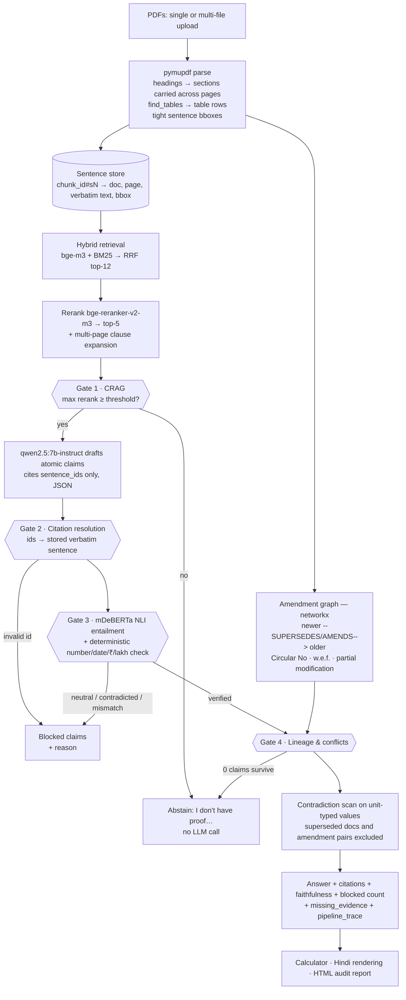

# Zero-Guessing Document AI

Hackasol 5.0 — Track 2: AIML, **Option B (AIML-02): Zero-Guessing & Contradiction-Checking Document AI**.

Ask questions across multiple PDFs and get answers that are **only** what the documents prove. Every claim carries a document, page and a **backend-resolved verbatim quote** (click it to see the highlighted PDF page). Unsupported or contradicted claims are **blocked**, conflicting documents are shown **side by side**, amendment chains decide *which rule is active*, and when proof is missing the system **abstains** instead of guessing.

**100% local · offline after model download · zero paid AI APIs** (Ollama + sentence-transformers + HuggingFace).

## What judges will see

| Capability | Where |
|---|---|
| Verbatim, clickable citations → highlighted PDF page (tables highlight the exact row) | Claims, contradictions, amendment edges |
| Claim-level blocking (`unsupported` / `neutral` / `contradicted`) + `faithfulness_pct`, `blocked_claims_count` | Metric cards |
| Amendment-aware contradictions (transitive: v1↔v3 is *not* a conflict) | Contradiction Alerts (side by side) |
| Amendment chain `v1 → v2 → v3`, active doc, every `SUPERSEDES/AMENDS` clause quoted | Amendment Chain |
| Safe abstention + **partial proof** (answers what is proven, flags what is not) | Presets 6 and 7 |
| Verified **Hindi** answers (English evidence, Hindi claim, re-verified) | Preset 5 |
| Deterministic calculator (Decimal math, no LLM arithmetic) | Calculation Working card |
| Live 4-gate verification trace and a print-ready HTML audit report | Trace card · *Export Audit Report* |

## Architecture — 4-gate verification & amendment-aware RAG



**Hindi** (`app/qa/translate.py`): claims are drafted and verified in English against the English quote; each verified claim is then rendered in Hindi and must itself pass mDeBERTa entailment, the numeric check, a script check (no stray Latin/foreign letters) and a **back-translation round-trip** (Hindi→English must be mutually entailed with the verified claim). A rendering that fails any check is dropped and the verified English claim is shown.

## Open-source models & hardware allocation (6 GB VRAM laptop, 16 GB RAM)

| Role | Model | Runs on | Why |
|---|---|---|---|
| Generator | `qwen2.5:7b-instruct` (Ollama, 4.7 GB) | **GPU** (100% in `ollama ps`) | Only model on the GPU → no eviction, no timeouts. `temperature 0, num_ctx 4096, num_predict 512, keep_alive 15m, format json` |
| Embeddings (EN+HI) | `BAAI/bge-m3` (sentence-transformers) | **CPU** | Keeps VRAM free for qwen |
| Reranker (EN+HI) | `BAAI/bge-reranker-v2-m3` | **CPU** | Lazy singleton, top-12 → top-5, CRAG gate |
| NLI (EN+HI) | `MoritzLaurer/mDeBERTa-v3-base-mnli-xnli` | **CPU** | True 3-class entailment/neutral/contradiction |

Settings live in `backend/.env` (`EMBEDDING_DEVICE=cpu`, `RERANKER_DEVICE=cpu`, `NLI_DEVICE=cpu`). **`HF_HUB_OFFLINE=1` / `TRANSFORMERS_OFFLINE=1`** stop HuggingFace from being contacted at runtime — set them to `0` only for the very first model download. Mocks exist only as injected fakes in `pytest`; every runtime default is a real model.

## Benchmarks (real models, no mocks — RTX 4050 6 GB, 16 GB RAM)

`scripts/live_e2e.py` against a running server (7 demo presets, fresh index, models warm; ingest of 4 PDFs / 26 chunks ≈ 15 s):

| Preset | Status | Latency | Faithfulness | Blocked | Verified claims | Conflicts |
|---|---|---|---|---|---|---|
| 1 Active rule (amendment chain) | contradicted¹ | 7.8 s | 100% | 0 | 1 | 1 |
| 2 Contradiction alert | contradicted | 17.3 s | 100% | 0 | 4 | 2 |
| 3 Multi-page + fee table | answered | 22.2 s | 100% | 0 | 6 | 0 |
| 4 Calculation → **Rs 2,000** | contradicted¹ | 17.3 s | 100% | 1² | 2 | 1 |
| 5 Hindi (Devanagari, NLI-verified) | contradicted¹ | 17.1 s | 100% | 0 | 1 | 1 |
| 6 Abstention (crypto collateral) | abstained | 8.6 s | N/A | 0 | 0 | 0 |
| 7 Partial proof (late fee ✔ / SWIFT fee flagged missing) | contradicted¹ | 13.0 s | 100% | 0 | 1 | 1 |

¹ `contradicted` = the answer is verified (2%/month from the active v3) **and** an unresolved conflict exists (`Acme_Operations_Notice.pdf` says 5% / 5-day grace). ² The LLM drafted an extra claim that failed NLI/numeric verification and was blocked — never shown.

### Golden Evaluation Benchmark (24 labelled cases, reproducible)

`data/eval/golden_dataset.json` holds 24 hand-labelled questions: Acme (v1→v2→v3 amendment chain, fee table, multi-page clause, Operations Notice contradiction, superseded negative controls, abstention, partial proof, calculation, missing-input clarification, Hindi), the real RBI circulars `DoR.MCS.REC.28/61/38`, and the Hackasol booklet (AIML-02 vs CS-01). Each case stores `expected_doc_ids`, `expected_pages`, `expected_status`, `expected_active_doc`, `expect_contradiction`, `expect_abstention`, `expected_value`. Gold labels come from the PDFs, never from model output.

```bash
python backend/scripts/evaluate.py --retrieval-only   # 4-way ablation, zero LLM calls
python backend/scripts/evaluate.py --full             # real local models, Acme + RBI (add --corpora all for Hackasol)
```
Output: `data/reports/golden_eval_report.json` (+ `.md`). Real PDFs are read from `data/uploads/`; a corpus whose PDFs are missing is skipped with a warning.

**Retrieval ablation** (21 answerable questions, top-5; relevant = chunk lies on a gold doc+page)

| Retrieval mode | Recall@5 | Precision@5 | MRR@5 |
|---|---|---|---|
| (a) BM25 only | 90.5% | 45.7% | 0.770 |
| (b) Dense `bge-m3` only | 95.2% | 53.3% | 0.853 |
| (c) Hybrid RRF (`bge-m3` + BM25) | 92.9% | 49.5% | 0.821 |
| **(d) Contextual hybrid + `bge-reranker-v2-m3` (ours)** | **95.2%** | 50.5% | **0.897** |

The reranker's win is ranking quality (MRR), not recall: dense-only ties it on Recall@5 and has slightly higher Precision@5. Precision@5 is capped because gold is usually 1–2 pages while 5 chunks are returned.

**End-to-end** (22 questions, Acme + RBI, qwen2.5:7b + bge-m3 + reranker + mDeBERTa, one in-process run)

| Metric | Result |
|---|---|
| Faithfulness (shown sentences backed by a verified quote) | 100% (28/28) |
| Hallucination leakage (independent audit, lower is better) | 3.6% (1/28) |
| Citation exact-match (quote verbatim on cited PDF page, re-read with PyMuPDF) | 100% (30/30) |
| Abstention accuracy | 90.9% (20/22) |
| Contradiction precision / recall | 71.4% / 100% (TP 5, FP 2, FN 0) |
| Superseded false-positive rate | 0% (0/7 negative controls) |
| Amendment-resolution accuracy | 100% (12/12) |
| Latency median / p95 | 16.3 s / 28.7 s (run alone on the CPU) |

Known misses (not tuned away): GD-11 (home-loan interest question) answered with the *personal-loan* 7% rate instead of refusing — the 1 leaked claim; GD-18 (RBI multi-page clause) abstained; GD-02, GD-16 returned `partially_answered`, GD-09 `contradicted`, where the label says `answered`. Gate 1 (CRAG threshold) refused 0/3 no-proof questions before generation; refusals came from Gates 2–4. Latencies were measured with the evaluation alone on the CPU. Leakage counts a claim if it is uncited, its quote is absent from the PDF page, it contains a number absent from its quotes, contains a forbidden value, or is shown where the right answer is a refusal. Unit tests: **100 passing** (`pytest`).

## 60-second setup & demo

```bash
# 0. once: models
ollama pull qwen2.5:7b-instruct
# (first run only, HF models download once; then keep HF_HUB_OFFLINE=1 in backend/.env)

# 1. backend  (Python 3.11+)
cd backend && python -m venv .venv && source .venv/bin/activate
pip install -r requirements.txt && cp .env.example .env
uvicorn app.main:app --port 8000

# 2. frontend  (Node 20+) — new terminal
cd frontend && npm install && npm run dev        # http://localhost:5173
```

Demo walkthrough (≈ 3 minutes):

1. Click **Load Demo Sample PDFs** (4 PDFs: Loan Policy v1→v2→v3 + an unrelated Operations Notice). Corpus health shows pages, chunks, table chunks, amendment edges.
2. **#1 Active Rule** → `2% per month`, cited to v3; the chain `v1 → v2 → v3 (ACTIVE)` shows each `SUPERSEDES` clause. Click a citation chip: the right-hand drawer shows the page with the exact sentence highlighted.
3. **#2 Contradiction** → Ops Notice (5%, 5-day grace) vs v3 (2%, 15-day grace) side by side; v1 vs v3 is correctly *not* flagged.
4. **#3 Multi-page & table** → fee-table rows (click one: the row is highlighted) + an eligibility clause that continues from page 2 to page 3.
5. **#4 Calculation** → `Rs 50,000 × 2% × 2 months = Rs 2,000`, with the cited rate and step-by-step working.
6. **#5 Hindi**, **#6 Abstention**, **#7 Partial proof** (SWIFT fee flagged as missing, no number invented).
7. Open **Verification Pipeline Trace (4 Gates)**, then **Export Audit Report** (print-ready HTML).
8. Upload your own PDFs (drag & drop, multi-select); delete one or **Clear All**.

## API

| Endpoint | Purpose |
|---|---|
| `POST /api/ingest` · `POST /api/ingest/samples` | Upload PDFs / load demo corpus |
| `GET /api/documents` · `DELETE /api/documents/{id}` · `DELETE /api/documents` | List (+ corpus summary), delete one, clear all |
| `POST /api/ask` | Verified answer: `claims`, `blocked_claims`, `missing_evidence`, `contradictions`, `amendment_chains`, `calculation`, `pipeline_trace`, `faithfulness_pct`, `blocked_claims_count` |
| `GET /api/contradictions` | Corpus-wide, amendment-aware conflict scan |
| `GET /api/documents/{id}/page/{n}/render?sentence_id=…` | PNG with the cited passage highlighted |
| `POST /api/report` → `GET /api/report/{id}/download` | Executive HTML / JSON / Markdown audit report |

## Real-world PDFs

Amendment detection understands `supersedes / replaces / amends`, `in partial modification of`, `hereby amended to read as`, `Circular No. …`, `Master Direction …`, `w.e.f.` / `with effect from` / `dated dd.mm.yyyy`. Numbers are normalised across `₹`, `Rs.`, `INR`, `lakh`/`crore` and Indian grouping (`1,00,000` = `1 lakh`). Tables are extracted with `find_tables()`; scanned PDFs need OCR (not bundled).

## Workspaces & conversational layer

- **3 modes** (top bar): *Bank Admin* (manage the official corpus + live Compliance Audit banner), *Bank Customer* (same `bank_official` corpus, read-only UI) and *BYO Private Docs* (`byo_private`, an isolated sandbox for any unseen PDF).
- **Isolation:** every endpoint takes `?workspace=bank_official|byo_private` (default `bank_official`, so old clients/scripts are unchanged). Each workspace has its own documents, chunks, BM25/vectors, amendment graph and `data/index/<workspace>/` folder. bge-m3, bge-reranker-v2-m3 and mDeBERTa stay **process-wide singletons** shared by both, so a second workspace costs no model RAM. `GET /api/workspaces/summary` returns per-workspace `doc_count`, `chunk_count`, `amendment_chains_count`, `unresolved_contradictions_count`.
- **Chat memory is not evidence.** `POST /api/ask` accepts `history` (last 2 turns used). It can only change *which question string* enters Gates 1-4 (or ask for missing calculation inputs); history is never passed to claim drafting and never cited. Responses add `rewritten_question` (shown as "Resolved follow-up") and `clarification_needed` (slot form: calculation without amount/months returns the verified active rate and asks, instead of guessing). Logic: `backend/app/qa/followup.py`.

## Tests & checks

```bash
cd backend  && PYTHONPATH=. pytest -q && ruff check .
cd frontend && npm run lint && npm run build
python backend/scripts/live_e2e.py http://127.0.0.1:8000     # real models, 7 presets
python backend/scripts/evaluate.py --retrieval-only          # golden ablation
python backend/scripts/evaluate.py --full                    # golden end-to-end, real models
```

## Project docs

[AGENTS.md](AGENTS.md) · [docs/PRD.md](docs/PRD.md) · [docs/ARCHITECTURE.md](docs/ARCHITECTURE.md) · [docs/VERIFICATION_PIPELINE.md](docs/VERIFICATION_PIPELINE.md) · [docs/DATA_MODEL.md](docs/DATA_MODEL.md) · [docs/API_CONTRACT.md](docs/API_CONTRACT.md) · [docs/DATASET_AND_EVAL.md](docs/DATASET_AND_EVAL.md) · [docs/DEMO_SCRIPT.md](docs/DEMO_SCRIPT.md) · [docs/TECH_STACK.md](docs/TECH_STACK.md)

## No-paid-API compliance

No OpenAI / Anthropic / Gemini / Cohere / Voyage or other paid SDKs; no external AI endpoints in the request path; LLM, embeddings, reranker and NLI all run locally and the demo works offline after the one-time model download.
